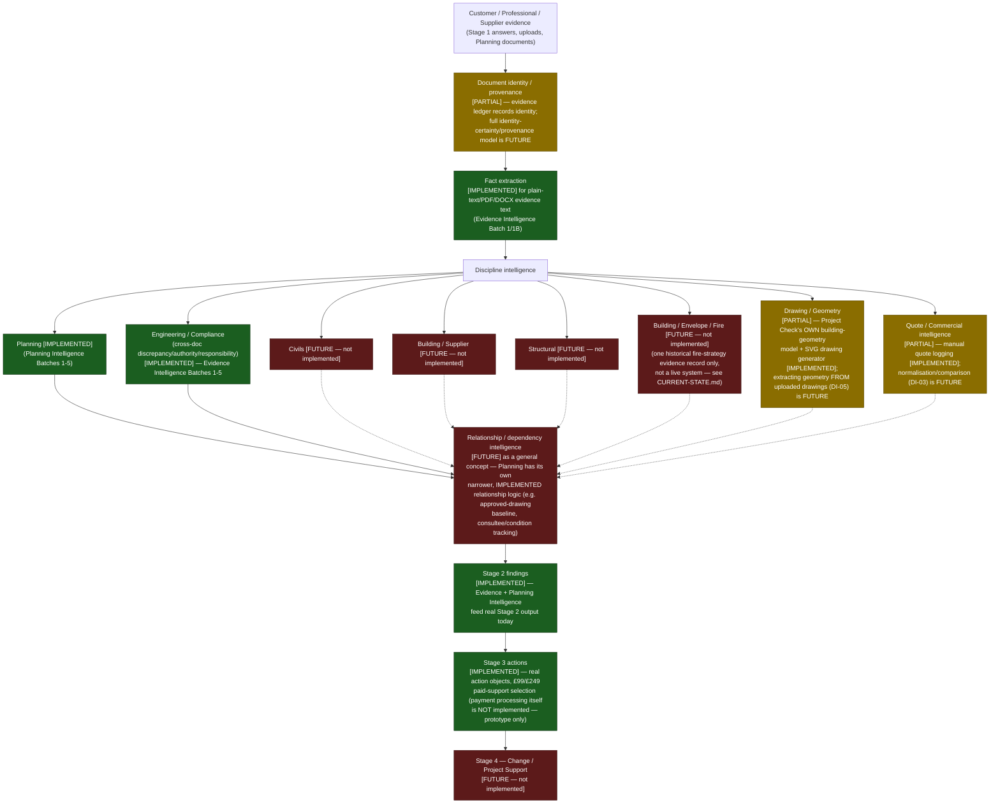

> **HISTORICAL – archived, not current.** Migrated 25 Nov 2026 from the private repo Project-Check-MVP-Master-Build (approved or older branches). Superseded by docs/governance, docs/continuity and CLAUDE.md. Kept for reference only. Client jobs anonymised as Job A–O; prices, IDs and security details redacted.

# Project Check — Architecture Map

One-page conceptual map. This is a navigation aid, not a specification — the authoritative detail lives in `Project-Check-MVP-Master-Build/MASTER-SPEC.md` and `Project-Check-MVP-Master-Build/EVIDENCE-INTELLIGENCE-SPEC.md` (see `GOVERNANCE-INDEX.md`).

**Read the labels literally.** `[IMPLEMENTED]` means real, working code exists today. `[PARTIAL]` means a genuine but narrower piece exists. `[FUTURE]` means it is recorded governance/architecture only — **no code exists for it**. Nothing below is future architecture dressed up as live behaviour.

## The conceptual pipeline

## Discipline branches — status at a glance

| Branch | Status | Real home (if any) |
|---|---|---|
| Planning | **IMPLEMENTED** | `evidence.js` Planning Intelligence Batches 1–5 |
| Civils | **RECORDED FUTURE ARCHITECTURE** | none — governance only, `EVIDENCE-INTELLIGENCE-SPEC.md` |
| Building / Supplier | **RECORDED FUTURE ARCHITECTURE** | none — governance only |
| Structural | **RECORDED FUTURE ARCHITECTURE** | none — governance only |
| Engineering / Compliance (cross-document discrepancy, authority, responsibility) | **IMPLEMENTED** | `evidence.js` Evidence Intelligence Batches 1–5 |
| Building / Envelope / Fire | **RECORDED FUTURE ARCHITECTURE** | one *historical, non-live* evidence record only (see `CURRENT-STATE.md`) |
| Drawing / Geometry | **PARTIALLY IMPLEMENTED** | `geometry.js` + `drawing.js` (Project Check's own geometry model/drawing generator — not extraction from uploaded drawings) |
| Quote / Commercial Intelligence | **PARTIALLY IMPLEMENTED** | `app.js` `quotes()`/`addQuote()` (manual log only, no normalisation) |

## DI-01 through DI-06 — status

All six are recorded in `EVIDENCE-INTELLIGENCE-SPEC.md` § "Data Intelligence findings" as **RECORDED FUTURE ARCHITECTURE, NOT YET IMPLEMENTED**. None has a dependency engine, change engine, quote-comparison engine, drawing parser, OCR, or geometry-extraction capability built against it. Where a narrower, already-implemented piece exists, it's noted:

| | Concept | Status | Narrower existing piece (if any) |
|---|---|---|---|
| DI-01 | Upload inventory persistence | FUTURE | The evidence ledger (`createEvidenceRecord()` in `evidence.js`) already records identity-ish fields per document — a real but narrower piece, not the full future model |
| DI-02 | Project change intelligence | FUTURE | none |
| DI-03 | Quote normalisation | FUTURE | Manual quote log only (`app.js`) |
| DI-04 | Engineering dependency chain | FUTURE | none |
| DI-05 | Drawing intelligence & geometry extraction | FUTURE | none (Project Check's own drawing generation is unrelated — see Drawing/Geometry above) |
| DI-06 | Drawing revision impact | FUTURE | none |

## Where this map comes from

This diagram reflects the pipeline described in `EVIDENCE-INTELLIGENCE-SPEC.md` § "Real-world Civils, Structural & Cross-Discipline Discovery (2026-08-27)" and `MASTER-SPEC.md` § "Stage 1–4 continuity & real-world engineering dependency" — both are **RECORDED FUTURE ARCHITECTURE** for everything not separately confirmed IMPLEMENTED here. For the precise, area-by-area implementation status, see `CURRENT-STATE.md` — this page is intentionally kept high-level and readable rather than exhaustive.
